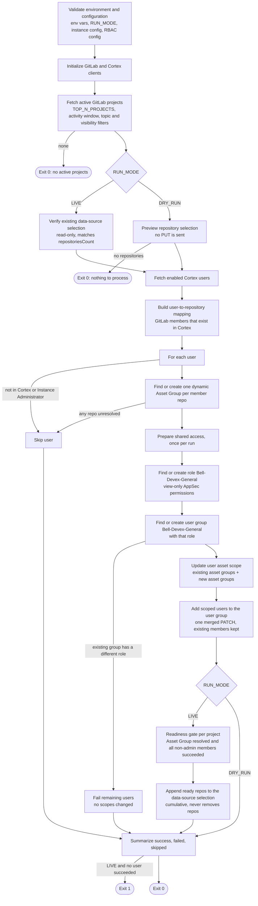

# GitLab-Cortex Cloud Synchronization Workflow

## Overview

The `gitlabCortexSync.py` script synchronizes GitLab projects and users with Cortex Cloud Application Security by automatically:

1. **Fetching active GitLab projects** based on activity thresholds
2. **Building user-to-repository mappings** from GitLab
3. **Granting shared Cortex Cloud access** by scoping each user to their repositories' Asset Groups and adding them to one user group that carries a view-only AppSec role
4. **Selecting missing repositories** in Cortex Cloud data sources

---

## Process Flow



The user's direct role is never changed. Access is granted only through membership in the shared user group, plus the user's asset scope. In `DRY_RUN`, every write in this flow is logged and skipped; missing roles, user groups, and Asset Groups are reported as "would create".

---

## Required Environment Variables

These must be set before running the script:

| Variable | Description | Example |
|----------|-------------|---------|
| `GITLAB_TOKEN` | Personal access token for GitLab API | `glpat-xxxxxxxxxxxxx` |
| `CORTEX_API_KEY_ID` | Cortex Cloud API key ID | `api_key_id` |
| `CORTEX_API_SECRET` | Cortex Cloud API secret key | `api_secret` |
| `GITLAB_CONFIG_KEY` | Selects the GitLab/Cortex configuration entry to use | `ug-onprem-prod` |

**Note:** In CI/CD pipelines, credentials are typically provided via Vault. The selected `GITLAB_CONFIG_KEY` is resolved against the JSON config file at `config/gitlab_instances_config.json` unless overridden.

---

## GitLab Instance Configuration File

The script loads GitLab and Cortex data source settings from:

- `config/gitlab_instances_config.json`

Each entry must define:

| Field | Description |
|-------|-------------|
| `url` | Base GitLab host URL used to build the API URL |
| `cortex-data-source-id` | Cortex Cloud GitLab data source ID associated with that GitLab instance |
| `use-topic-filtering` | If `true`, only projects tagged for Unified-Prisma processing are included |

Each entry may also define:

| Field | Description |
|-------|-------------|
| `visibility` | Optional GitLab visibility filter applied when listing projects, for example `private` |

Example:

```json
{
  "ug-saas-prod": {
    "url": "https://gitlab.com",
    "cortex-data-source-id": "1234",
    "use-topic-filtering": false,
    "visibility": "private"
  },
  "ug-onprem-prod": {
    "url": "https://gitlab.int.bell.ca",
    "cortex-data-source-id": "5678",
    "use-topic-filtering": true
  }
}
```

---

## Optional Environment Variables

| Variable | Description | Default |
|----------|-------------|---------|
| `ACTIVITY_THRESHOLD_MINUTES` | Time window for determining project activity | `30` |
| `LOG_LEVEL` | Logging level: DEBUG, INFO, WARNING, ERROR, CRITICAL | `INFO` |
| `GITLAB_INSTANCE_CONFIG_FILE` | Custom path to the GitLab/Cortex instance JSON config file | `config/gitlab_instances_config.json` |
| `CORTEX_API_URL` | Custom Cortex Cloud API URL | `https://api-yourfqdn` |
| `CORTEX_HOST_URL` | Custom Cortex Cloud host URL used when `CORTEX_API_URL` is unset | `https://api-yourfqdn` |
| `CORTEX_RBAC_CONFIG_FILE` | JSON configuration for the shared role and user group names, role permissions, and automatic per-repository asset groups | `config/cortex_rbac_config.json` |
| `RUN_MODE` | Execution mode: `DRY_RUN` (no changes) or `LIVE` (apply changes) | `DRY_RUN` |
| `TOP_N_PROJECTS` | Number of active projects to synchronize | `100` |

---

## Execution Modes

### DRY_RUN (Default)
- Performs all Cortex write operations **without applying changes**
- Safe for validation and testing
- Useful for preview before going live
- No modifications made to Cortex Cloud or GitLab

### LIVE
- **Applies all changes** to Cortex Cloud
- Creates the shared role/user group when missing, adds users to that group, updates user scopes, and selects repositories
- Use with caution in production environments

### Cortex Repository Selection

The synchronizer requires `MANUAL_SELECTION`. For GitLab integrations, the data-source record omits `state`; the sync therefore gets all repository records and selects only those whose `integrationId` matches this data-source ID and whose `isSelected` value is `true`. It uses `owner/name` as the GitLab repository path and verifies that this selected set matches `repositoriesCount` before writing. In LIVE mode, it maps members and applies the required Asset Groups, scopes, and user-group membership before selecting repositories. A project is appended only when it passes the GitLab filters, its Asset Group resolves, and each mapped non-admin member's scope and group-membership processing succeeds. It sends a cumulative update containing the existing selected repository names plus only eligible missing repos. The data source's scope will no longer auto-discover future repos; the synchronizer is additive and does not remove repos.

A first live run that changes an auto-discovery source to manual can change its future onboarding behavior. Review the source's current state before running it; an administrator should confirm this transition is intended. `RUN_MODE=DRY_RUN` does not apply the mode change.

---

## Local Testing

The repository includes network-free tests for GitLab filtering and Cortex API behavior:

- [tests/test_gitlab_client.py](../tests/test_gitlab_client.py) tests required topics and topic filtering.
- [tests/test_cortex_client.py](../tests/test_cortex_client.py) tests Cortex headers, read-only lookups, repository selection payloads, role/user-group payloads, and dry-run mutation protection.

Run the tests from the repository root:

```bash
python -m unittest discover -s tests -v
```

The tests use mocked HTTP responses. They do not require GitLab or Cortex credentials and do not contact external services.

Run syntax and configuration checks separately:

```bash
python -m py_compile gitlabCortexSync.py client/cortex_client.py client/gitlab_client.py common/utils.py
python -m json.tool config/gitlab_instances_config.json
```

In `DRY_RUN`, read-only Cortex endpoints are allowed so users, roles, and user groups can be inspected:

```http
POST /public_api/v1/rbac/get_users
POST /public_api/v1/rbac/get_roles
GET /platform/iam/v1/user-group
```

Cortex mutations remain blocked, including repository data-source updates, role creation, user-group creation, and user-group membership updates.

## Customer Validation

Local tests cannot verify tenant-specific Cortex permissions, data-source IDs, repository response fields, or live user-group membership. The customer should validate these steps in an isolated test environment:

1. Configure the correct `cortex-data-source-id` for the GitLab instance.
2. Confirm the Cortex API key can read users, roles, user groups, repositories, and data sources.
3. Confirm every `component_permissions` entry in `config/cortex_rbac_config.json` exists in the tenant's permission configuration.
4. Run with `RUN_MODE=DRY_RUN` and review the logs.
5. Test with one repository and one non-production Cortex user.
6. Run with `RUN_MODE=LIVE` only after the dry-run output is approved.
7. Verify the repository selection, the `Bell-Devex-General` role and user group, the user's group membership, and that the user's original direct role is unchanged in Cortex.

Repository groups are created automatically. Before creating a group, the sync queries `POST /public_api/v1/asset-groups` with `{"request_data": {}}` to retrieve the full group list, then matches the deterministic name locally. The list returns names and IDs as `XDM.ASSET_GROUP.NAME` and `XDM.ASSET_GROUP.ID`. If Cortex reports that the group name already exists during creation, the sync refreshes the full list and reuses the existing group's ID. New groups use two AND membership conditions: `xdm.asset.provider = GITLAB_SELF_MANAGED` (the `asset_provider` client parameter) and `xdm.repository.name = <repository full path>`. This prevents matching a non-repository asset that happens to have the same name. The returned group ID is then used in each member's scope. No per-repository asset-group IDs need to be maintained by an operator.

`config/cortex_rbac_config.json` contains the shared role name, shared user-group name, editable component permissions, repository type value, and generated-group name prefix:

```json
{
  "component_permissions": [
    "app_sec_issues_view",
    "app_sec_scans_periodic_view",
    "app_sec_scans_pr_view",
    "app_sec_scans_ci_cd_view",
    "app_sec_detection_rules_view",
    "app_sec_policies_view",
    "app_sec_supply_chain_tools_view"
  ],
  "role_name": "Bell-Devex-General",
  "user_group_name": "Bell-Devex-General",
  "asset_group_repository_type": "GITLAB_REPOSITORY",
  "asset_group_name_prefix": "gitlab-repo-"
}
```

The permissions are the view permissions of the Application Security category: Issues, Scans (Periodic, PR Scans, CI CD Scans), Policy Management (AppSec Rules, AppSec Policies), and 3rd Party Tools (Supply Chain Tools). AppSec Collector > Generic Collector exposes no view permission in the tenant's permission list (only the `generic_collector` action), so it cannot be part of a view-only role.

### Shared role and user group

A Cortex user has a single direct role. Earlier versions assigned a generated `devex_<user>` role through `set_user_role`, which replaced the user's original, possibly broader, role. The sync no longer assigns direct roles. Instead it:

1. Finds the `role_name` role through `POST /public_api/v1/rbac/get_roles`, or creates it once through `POST /platform/iam/v1/role` with `component_permissions`.
2. Finds the `user_group_name` group through `GET /platform/iam/v1/user-group`, or creates it through `POST /platform/iam/v1/user-group` with that `role_id`. If a group with that name already exists with a different role, the sync stops processing users instead of changing the group's role.
3. Adds the scoped users with one `PATCH /platform/iam/v1/user-group/{group_id}` per run. Because `users` replaces the member list, the request contains the existing members plus the new users. Members are never removed, and no request is sent when everyone is already a member.

Users keep their original direct role; the group role is added to it.

For each developer, the code ensures one group per member repo, unions the group IDs, updates that user's Cortex Assets scope, and then adds the user to the shared user group. New repositories are handled automatically on their first sync; existing deterministic groups are reused on later syncs. If Cortex accepts the manual data-source update before its AppSec repository inventory has indexed the new repo, the synchronizer still continues using the selected GitLab path and can create the dynamic group in that run. Cortex may take time to associate the new asset with that group, so the user may not see findings until ingestion and group evaluation complete. If the group API fails, the code fails closed and does not add the user to the shared group without the computed scope.

Group membership requires an identity that already exists in Cortex. The supplied Cortex User API supports listing, getting, and editing users, but does not document a user-creation endpoint. Therefore, a developer who has never logged into Cortex can still be added to the group if their account has already been provisioned in Cortex (for example through the customer's SSO/IdP process). If the account is absent from Cortex, this script skips it; the customer must provision the identity first.

The scope update is additive. Asset groups that the user is already scoped to are kept, and the asset groups of this run's member repositories are added, so a repository that falls outside the activity window or `TOP_N_PROJECTS` in a later run does not remove access granted earlier.

The scope update first reads the user's current scope, then calls `PUT /platform/iam/v1/scope/user/{email}`. It changes only `assets` (existing scoped asset-group IDs plus the new IDs) and preserves existing `endpoints`, `cases_issues`, and (when returned) `datasets_rows` settings. If the user's assets scope was `no_scope` (all assets), the update changes it to `scope` and limits the user to the computed asset groups; this applies to every role the user has. If no endpoint or cases/issues scope exists, the request uses `no_scope` for those sections; this avoids granting unrelated access. The Cortex API requires both `endpoints` and `cases_issues` in the update body, and requires `datasets_rows` when dataset row scoping is enabled for the tenant. A successful update therefore has this shape:

```json
{
  "request_data": {
    "assets": {
      "mode": "scope",
      "asset_group_ids": [101, 202]
    },
    "endpoints": {
      "endpoint_groups": {"mode": "no_scope", "names": []},
      "endpoint_tags": {"mode": "no_scope", "names": []}
    },
    "cases_issues": {
      "mode": "no_scope",
      "include_cases_issues_empty_entities": false,
      "names": []
    }
  }
}
```

Cortex does not allow scope updates on Instance Administrator entities. Users identified as administrators from Cortex role metadata are skipped before asset-group, scope, or group-membership changes; administer their access directly in Cortex. If metadata does not identify an administrator, Cortex's explicit admin-scope rejection still prevents adding that user to the group. Other scope-update failures also prevent group membership.

The repository API's asset IDs are not SBAC asset-group IDs; the API-created dynamic group supplies the required integer group ID. SBAC must be enabled in Cortex Server Settings. The filter uses the XQL asset type and name fields supplied for the customer's repository inventory query. Verify the exact field identifiers are accepted by the tenant's Asset Groups API with one test repo before enabling LIVE. Cortex docs recommend keeping total asset groups below roughly 2,000; this design creates one per GitLab repo and stops creating groups near that limit. Also confirm users do not receive broader permissions/scopes through other assigned roles or groups; Cortex combines access from assignments.

If the permission list is changed, the existing `Bell-Devex-General` role is not automatically updated by this client; Cortex's documented IAM Roles API in the supplied reference does not expose a role-edit operation. Update the role in Cortex as part of a permission change. Roles named `devex_<user>` created by earlier versions are no longer used; restore each affected user's original role in Cortex and then delete those roles.

Do not use production users or broad repository selections for the first live test.

### Adding another source-control provider

The orchestrator depends on the `SCMClient` contract in [client/scm_client.py](../client/scm_client.py), not on `GitLabClient`: `get_active_projects(top_n, last_minutes)` and `get_project_members(project_id, include_inherited)`. A `github_client.py` must return projects with `id` and `path_with_namespace` (`owner/name`) and members with `username`, `email`, `name`, and `access_level`. On the Cortex side, pass the matching `asset_provider` value to `CortexClient`. The user-group, role, and scope logic is provider-independent.

Still GitLab-specific and to change when adding a provider: the `GITLAB_*` environment variables, `config/gitlab_instances_config.json` (including the `/api/v4` suffix in `get_gitlab_config`), the `gitlab_key` client argument that seeds Asset Group names (renaming it changes the generated names), `DEFAULT_GITLAB_ACCESS_LEVEL` in `common/utils.py`, and the unused `asset_group_repository_type` setting.

---

## Exit Codes

| Code | Meaning | Action |
|------|---------|--------|
| `0` | **Success** | Script completed successfully |
| `1` | **Failure** | Configuration validation or processing error, or a LIVE run where no user succeeded (see logs for details) |

---

## Key Functions

### `validate_environment()`
- Checks that all required environment variables are present
- Exits with error if any are missing
- Logs confirmation on success

### `get_runtime_config()`
- Parses optional environment variables
- Validates `RUN_MODE` is either `DRY_RUN` or `LIVE`
- Returns configured values with defaults

### `load_gitlab_instance_config()`
- Loads GitLab and Cortex data source settings from the JSON config file
- Validates entry structure and required fields
- Raises a configuration error for missing files, invalid JSON, or incomplete entries

### `get_gitlab_config()`
- Resolves the selected entry from `GITLAB_CONFIG_KEY`
- Derives the GitLab API URL from the selected `url`
- Returns the Cortex data source ID and topic-filtering mode for the selected entry

### `initialize_clients(run_mode)`
- Creates GitLab API client with provided token
- Resolves GitLab and Cortex settings from the selected config entry
- Creates the Cortex Cloud client with API key ID and secret
- Sets the Cortex client to dry-run mode if `RUN_MODE=DRY_RUN`

### `fetch_active_projects(gitlab, top_n_projects, activity_threshold_minutes, run_mode)`
- Queries GitLab for active projects
- Filters based on activity in the last N minutes
- Limits results to top N projects
- Logs count of projects found

### `activate_repositories(cortex, projects, cortex_data_source_id)`
- Identifies GitLab repositories not selected in the Cortex data source
- Sends one cumulative selection update: existing selected repositories plus the missing ones; never removes repositories
- Returns a lookup of repository paths to Cortex repository IDs
- Respects `DRY_RUN` mode for preview

### `projects_ready_for_repository_selection(cortex, projects, user_repos, role_results)`
- LIVE only; runs after user processing
- Keeps a project only when its Asset Group resolves and every non-admin member succeeded
- Only these projects are passed to `activate_repositories`

### `build_user_mapping(projects, gitlab, cortex_repo_lookup)`
- Extracts user information from GitLab projects
- Maps each user to their accessible repositories
- Uses parallel processing for performance
- Returns dictionary of user-to-repos mappings

### `create_or_update_user_roles(user_repos)`
- Ensures the shared view-only role and user group exist
- Updates each user's asset scope, then adds the users to the shared group without replacing their direct role
- Respects `DRY_RUN` mode for preview

### `summarize_role_sync(results)`
- Counts successful, failed, and skipped operations
- Treats users not found in Cortex and Instance Administrators as skipped
- Logs errors for any failed synchronizations
- In LIVE, returns failure (exit code 1) when no user succeeded and at least one failed

---

## Signal Handling

The script gracefully handles termination signals:

| Signal | Trigger | Behavior |
|--------|---------|----------|
| `SIGINT` | Ctrl+C | Logs interrupt message, performs cleanup, exits with code 0 |
| `SIGTERM` | Termination request | Same as SIGINT |

---

## Error Handling

The script handles multiple error types:

- **`CortexClientError`**: Issues with Cortex Cloud API communication
- **`requests.exceptions.RequestException`**: Network/HTTP errors
- **`ValueError`**: Invalid data or parsing errors
- **`EnvironmentValidationError`**: Missing or invalid environment variables
- **Other exceptions**: Logged as unexpected errors

All exceptions are logged with full traceback and the script exits with code 1.

---

## Logging

All operations are logged with timestamps and severity levels:

- **DEBUG**: Detailed diagnostic information
- **INFO**: General informational messages (start/end of major steps)
- **WARNING**: Warning about skipped users or partial failures
- **ERROR**: Errors that prevent successful completion
- **CRITICAL**: Critical system failures

Logs help with:
- Auditing synchronization activities
- Troubleshooting failures
- Verifying operations in DRY_RUN mode before going LIVE

---

## Example Usage

### Local Development (DRY_RUN)
```bash
export GITLAB_TOKEN="glpat-xxxxxxxxxxxx"
export CORTEX_API_KEY_ID="api_key_id"
export CORTEX_API_SECRET="api_secret"
export GITLAB_CONFIG_KEY="ug-onprem-prod"
export RUN_MODE="DRY_RUN"
export TOP_N_PROJECTS="10"
export LOG_LEVEL="INFO"

python gitlabCortexSync.py
```

### CI/CD Pipeline (LIVE)
```bash
export RUN_MODE="LIVE"
export GITLAB_CONFIG_KEY="ug-onprem-prod"
python gitlabCortexSync.py
# (Credentials provided via Vault)
```

---

## Workflow Summary

1. **Initialization**: Validate environment, load clients
2. **Discovery**: Find active GitLab projects within threshold
3. **Verification**: Check the existing Cortex data-source selection (LIVE) or preview it (DRY_RUN)
4. **Mapping**: Build user-to-repository relationships for enabled Cortex users
5. **Access**: Create/reuse per-repo Asset Groups, the shared role and user group; update user scopes; add users to the group
6. **Registration**: Select ready repos in the Cortex data source (LIVE)
7. **Reporting**: Summarize results with success/failure counts

The entire process is logged for audit and troubleshooting purposes, with `DRY_RUN` mode available for safe preview before applying live changes.

---

## Recent Updates

### Shared role and user group

- Replaced per-user `devex_<user>` roles and `set_user_role` with one shared view-only role, `Bell-Devex-General`, attached to a `Bell-Devex-General` user group. A direct role assignment replaced the user's original role, so users lost permissions.
- Users are added to the group with a merged `PATCH /platform/iam/v1/user-group/{group_id}`; existing members are kept.
- Replaced `role_name_prefix` with `role_name` and `user_group_name` in `config/cortex_rbac_config.json`, and extended `component_permissions` to every AppSec view permission.
- Asset scope updates now keep previously scoped asset groups.

### 2026-09-11

- Migrated the integration from Prisma Cloud to Cortex Cloud Application Security and Platform RBAC APIs.
- Added [client/cortex_client.py](../client/cortex_client.py) as the Cortex API client.
- Replaced Prisma authentication with Cortex `CORTEX_API_KEY_ID` and `CORTEX_API_SECRET` headers.
- Added Cortex data-source repository synchronization using:
  - `GET /public_api/appsec/v1/data_source_instances`
  - `GET /public_api/appsec/v1/repositories`
  - `PUT /public_api/appsec/v1/data_source_instances/{id}`
- Replaced Prisma integration IDs with `cortex-data-source-id` values in `config/gitlab_instances_config.json`.
- Updated the orchestrator to initialize `CortexClient`, select Cortex data sources, and use Cortex error handling.
- Added Cortex user discovery through `POST /public_api/v1/rbac/get_users`.
- Added Cortex role discovery through `POST /public_api/v1/rbac/get_roles`.
- Added generated per-user Cortex roles using `POST /platform/iam/v1/role` and the editable `component_permissions` list in `config/cortex_rbac_config.json`.
- Added Cortex user-role assignment through `POST /public_api/v1/rbac/set_user_role`.
- Preserved GitLab project activity filtering, required `CAL_Barcode:` topics, optional `Unified-Prisma` filtering, visibility filtering, pagination, member filtering, and parallel user mapping.
- Preserved `DRY_RUN` and `LIVE` execution modes, while allowing read-only Cortex RBAC POST requests during `DRY_RUN` and blocking mutations.
- Added retry handling for transient Cortex responses including `429`, `500`, `502`, `503`, and `504`.
- Added `.env` and `.env.example` using Cortex configuration names and safe dry-run defaults.
- Added mocked, network-free tests in [tests/test_cortex_client.py](../tests/test_cortex_client.py) and [tests/test_gitlab_client.py](../tests/test_gitlab_client.py).
- Added documentation for local testing and customer-side dry-run/live validation.
- Removed the obsolete Prisma client implementation and updated the workspace custom agent to target GitLab-Cortex RBAC work.
- Added automatic dynamic Cortex asset-group creation/reuse per GitLab repository, and per-user SBAC scope calculation from current GitLab membership.
- Added a configurable component permission list in that file; the root `permissionlist.json` is reference material only and is not loaded by runtime code.
- Documented that Cortex repository asset IDs and SBAC asset-group IDs are different identifiers and require customer-side mapping.

### 2026-04-23

- Replaced direct `GITLAB_INTEGRATION_ID` input with `GITLAB_CONFIG_KEY` selection.
- Moved GitLab/Prisma instance settings into `config/gitlab_instances_config.json`.
- Added runtime loading and validation for the external instance config file.
- Replaced `GITLAB_HOST_URL`-driven selection with config-file `url` entries.
- Added `GITLAB_INSTANCE_CONFIG_FILE` as an optional override for the default config path.
- Updated topic filtering behavior to be controlled by `use-topic-filtering` per config entry.
- Added optional per-instance `visibility` support so GitLab.com and on-prem filtering can be configured independently.

### 2026-04-05

- Extracted repository activation polling into a dedicated helper in [client/prisma_client.py](client/prisma_client.py): `_poll_for_activated_repos(...)`.
- Updated repository activation flow to send only newly discovered repositories (`is_new=True`) instead of re-sending all repositories.
- Added eventual-consistency polling after repository activation to confirm new repositories are visible before subsequent role updates.
- Added role sync helper `_update_appsec_ssdlc_sa_dev_role(...)` to keep the shared CI/CD role `appsec-ssdlc-sa-dev` aligned with integration repositories.
- Switched integration repository onboarding call to `POST /code/api/v2/repositories` payload format (`integrationId`, `integrationType`, `repositoriesNames`).
- Added integration type caching (`_load_integration_cache`, `get_integration_type`) to resolve integration metadata once and reuse it.
- Updated default-role assignment behavior: when a user's default role is `ssdlc_developer_base`, it is switched to the generated `devex_*` role during assignment.
- Improved exception messages in `activate_missing_repos_integration(...)` for clearer operational debugging.
